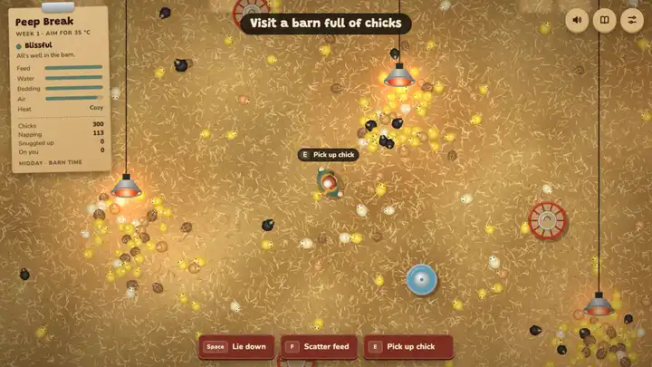

# 🐥 Peep Break

A barn full of chicks under heat lamps. Cozy mode is just for visiting. In Care mode you run the brooder and try to raise as many chicks as you can to week six (six real days). Includes a brooding guide for real chicks.

## Files

- `index.html` is the whole game: CSS, canvas rendering, chick behaviour and Web Audio sound in one file. The only external requests are for Google Fonts.
- `media/` holds the demo video and the looping preview above.
- `netlify.toml` deploys the folder as a static site, with no build step.

Open `index.html` in a browser to play locally.

## Controls

| Action | Keyboard / mouse | Touch |
| --- | --- | --- |
| Walk | WASD / arrows, or click the floor | Thumbstick, or tap the floor |
| Tiptoe | Hold Shift | Tiptoe button (on/off) |
| Pet | Click a chick (or the cat) | Tap a chick (or the cat) |
| Lie down / get up | Space | Lie down / Get up button |
| Scatter feed | F | Scatter feed button |
| Use / pick up / put down | E | Bottom-right button |
| Lower a lamp | Q | Lower lamp button (under a raised lamp) |
| Name a held chick | N | Name button (while holding one) |
| Sound | M | Speaker icon |
| Zoom | Scroll | Pinch |

Touch controls appear on phones and tablets, and whenever you touch the screen.

## License

[MIT](LICENSE)
